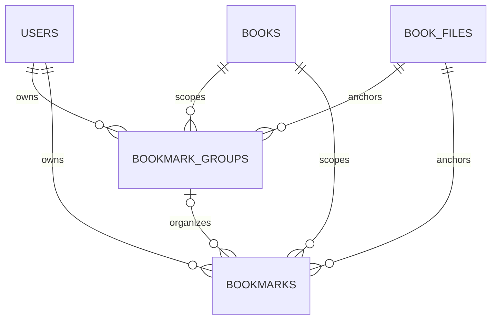

# Milestone 4 proposal — Private Bookmarks & Personal Table of Contents

**Status: proposed, not implemented.** Reviewed 2026-11-14 against the actual Milestone 3 working tree. This document is a reviewable implementation design, not authorization to implement it. No V5 file, application code, database objects, or new dependencies are created by this task.

## 1. Scope and inspected baseline

Milestone 4 adds private, page-anchored bookmarks with titles, colors, optional groups, and Reader navigation. A personal table of contents means flat, named groups containing bookmarks ordered by PDF page. It does not mean extracting the PDF's embedded outline, creating nested headings, or editing the PDF binary.

Preserve session Authentication, existing CSRF transport, protected routes, private file streaming, progress restoration/save ordering, single/double-page geometry, zoom, fit, fullscreen, selectable text and bounded canvas cleanup. My Library remains the existing page. Highlights, notes, public publishing, moderation, EPUB, S3, Finished Books, manual drag sorting and book replacement management are outside this proposal.

Reviewed sources:

- [AGENTS.md](../../AGENTS.md), [product requirements](../product/requirements.md), [business rules](../product/business-rules.md), product overview and coding conventions.
- [System design](system-design.md), [database design](database-design.md), [API conventions](api-conventions.md), [Authentication design](authentication-design.md), [Reader specification](../design/reader-spec.md), design system and roadmap.
- [Milestone 3 implementation report](../development/reading-progress-milestone-3.md), [current state](../development/current-state.md), and the earlier reader/upload reports.
- Actual `ReaderPage.tsx`, `LibraryPage.tsx`, `ContinueReadingSection.tsx`, all three current `components/reader/` components, reader CSS/utilities, PDF/progress hooks, services, auth/cache providers, shared Dialog/DropdownMenu and MobileNav.
- Existing backend entities, controllers, book/progress services, ownership-scoped repositories, response/error DTOs, exception handling, SecurityConfig, V1–V4 migrations and relevant migration/integration/browser tests.

The source has no bookmark entity, API, sidebar or V5 migration. `book_files.id` is already the immutable version key; V4 already supplies unique `book_files(book_id, id)`. Existing progress uses that key and an explicit canonical page. Earlier uncommitted Milestone 3 changes must be preserved during future work.

Review evidence includes the retained [Milestone 3 mobile Reader](../development/screenshots/progress-reader-mobile.png), [desktop Library](../development/screenshots/progress-continue-desktop.png) and [mobile Library](../development/screenshots/progress-continue-mobile.png). The older [desktop spread screenshot](../development/screenshots/reader-desktop-double.png) is useful for geometry only: its counter predates Milestone 3. Current source is authoritative. This task does not claim a fresh live-browser, screen-reader or accessibility audit.

## 2. Focused UI/UX review

The dedicated reading layout, restrained paper/forest palette, explicit page jumper, responsive single-page fallback, separate account save status and actual Continue Reading are sound foundations. Preserve them. The meaningful changes are below; integration risks are distinguished from current behavior.

### 2.1 Page-turn keyboard scope — required before sidebar integration

**Evidence:** `ReaderSession` handles Left/Right at `.reader-layout`, excluding inputs, textareas, selects and contenteditable elements, but not buttons, menus, radio groups or dialogs. A sidebar menu/color selector would therefore risk turning PDF pages while using its arrow keys, including React events bubbling from a portal.

**Proposal:** allow page-turn shortcuts only from the reading surface or otherwise noninteractive reader background; ignore `event.defaultPrevented`, editable/interactive targets, sidebar/editor/menu origins and any open modal. Keep explicit Previous/Next buttons working. Retain browser/system shortcuts. Test this before adding new controls; event propagation alone must not be the sole safeguard.

### 2.2 Toolbar and long titles — required integration constraint

**Evidence:** mobile already wraps layout and zoom controls into two rows; the header places title, back navigation, theme and fullscreen in one flex row. There is no long-title clamping. Simply appending bookmark/group controls would compete with the PDF and wrap unpredictably.

**Proposal:** add one labelled **Bookmarks** toggle near existing view controls and a **Bookmark page N** action inside the panel. Do not add all CRUD actions to the toolbar. Keep page layout and zoom as their existing named groups. Allow a bounded second toolbar row at narrow widths; wrap/clamp long title/author text while keeping the full accessible title. Never remove My Library, page navigation or fullscreen to make room. Minimum 44px interaction targets remain.

### 2.3 Save status hierarchy and page announcements — small improvement

**Evidence:** `.reader-prototype-note` falls to `.65rem` on mobile. Its status and top-of-reader error paragraphs compete for height. The footer's live counter contains only “of N”; changing the selected page is not reliably described by that span alone.

**Proposal:** reserve a compact, wrapping status area with at least 12px supporting text, readable errors and Retry. Keep **Position saved / Saving position / Position save failed** distinct from **Bookmark saved / Bookmark could not be saved**. Add a polite, atomic page announcement on explicit navigation, such as “Page 4 of 5; viewing pages 3–4.” Do not announce every resize, zoom render, background refetch or save keystroke. Do not change progress durability or flush semantics.

### 2.4 Sidebar and reading width — a new integration constraint

There is intentionally no Reader sidebar today. Add a closed-by-default panel without bringing AppShell or its library navigation into the Reader. The panel needs independent scrolling and a close control; the PDF keeps its own scrolling. `PdfSpread` already measures its actual container using ResizeObserver, so fit-to-width can respond without remounting the document or adding another PDF renderer.

Opening/closing the panel must not select a different page, write progress, reset manual zoom, or force a layout-mode change. At manual zoom, overflow belongs inside the PDF viewport. Do not make the entire Reader horizontally scrollable.

### 2.5 Fullscreen overlays — required technical prerequisite

**Evidence:** current shared DialogContent and DropdownMenuContent portal to their default body container; fullscreen is requested on the Reader root. Bookmark dialogs/menus placed outside that root would risk being unavailable in fullscreen.

**Proposal:** provide an optional portal container on the existing wrappers, preserving their default behavior for other pages. Render all bookmark overlays into an overlay host inside the Reader root. This is a small extension to shared primitives, not a new dialog system. Test actual fullscreen interaction. Radix documents custom [Dialog portal containers](https://www.radix-ui.com/primitives/docs/components/dialog#custom-portal-container) and the [Dropdown Menu portal container](https://www.radix-ui.com/primitives/docs/components/dropdown-menu#portal); the fullscreen risk is an inference from those defaults and the inspected Reader root.

### 2.6 Library hierarchy — optional small polish, not a prerequisite

The existing Continue Reading and All your books sections are intentional views of the same book. Keep their layout, upload action and resume behavior. Both list components currently render pagination even for one page; hiding navigation when `totalPages <= 1` would remove unnecessary disabled controls, especially on mobile. Defer broader card merging, cover generation, new Library bookmark pages or shelf redesigns. Bookmark navigation lives in the Reader.

## 3. Proposed product rules

These defaults are recommendations for review, not existing functionality.

1. **Save a page:** Bookmark page N captures the current **canonical** page and immutable file ID when pressed. Open a small editor with title `Page N`, default color `FOREST`, and group Ungrouped unless the user is already viewing a specific group. The user explicitly confirms Save. Keep the captured page visible if PDF navigation later changes; never silently retarget an open draft.
2. **Double-page convention:** if canonical page is 4 while spread 3–4 is shown, create page-4 bookmark. The button/editor explicitly says Page 4; there is no ambiguous “bookmark this spread” operation. To bookmark page 3, select page 3 with the existing jumper first. Single-page, zoom and fullscreen use the same PDF page index, starting at 1; printed page labels may differ.
3. **Titles:** editable, trimmed, nonblank, at most 120 characters; plain text only. Omitted create title defaults to `Page N`; explicit blank/null is invalid. Titles need not be unique. Validate Unicode length consistently between UI, DTO and database, including emoji; reject control characters and multiline titles. No automatic text extraction.
4. **Colors:** a fixed named enum `FOREST`, `AMBER`, `BLUE`, `ROSE`, `SLATE`. Color is optional on create and defaults to FOREST. No arbitrary CSS/hex input. Give each swatch a visible/accessibility name and a selected indicator. Color never substitutes for title/page or selection state.
5. **Duplicate page:** one bookmark per `(user, immutable file, page)` across all groups. Repeating Add opens the existing bookmark editor after a lookup; it never silently renames, recolors, moves or deletes it. The database unique constraint resolves simultaneous creates. A conflict returns 409; the UI locates the existing row by exact page and offers Edit.
6. **Groups:** flat and scoped to `(user, book, file version)`, not account-wide shared folders. Create, rename and delete; names are trimmed, nonblank, at most 80 characters, single-line text. Names are unique ignoring case within that scope, using the database's `lower(name)` comparison. No accent folding or hierarchy. All bookmarks and Ungrouped are virtual filters, never persisted group rows; reserve those two labels case-insensitively to prevent ambiguity.
7. **Organization:** each bookmark has zero or one group. `groupId: null` means Ungrouped. Move through the edit form's Group selector; no drag-and-drop requirement. Default list order is ascending PDF page, with ID tie-breaker. Group selectors/management use case-insensitive name order with ID tie-breaker. All bookmarks is a flat page-ordered list with group labels; choosing a group shows that group's page-ordered personal contents.
8. **Delete group safely:** confirmation says “Delete this group? Its bookmarks will move to Ungrouped.” The operation detaches bookmarks and deletes only the group in one transaction. Never cascade-delete the group's bookmarks. Empty groups are allowed. No soft-delete or undo service is needed; require explicit confirmation for bookmark deletion too.
9. **Jump:** selecting a bookmark uses the same validated `selectPage` path as the existing jumper. Keep mode/zoom/fullscreen; page 4 in double mode shows 3–4 with canonical page 4. Mobile closes the drawer and focuses the reading area after a successful jump. Navigation schedules the normal progress save; bookmark metadata CRUD itself does not change reading position, activity time or Continue Reading ordering.
10. **Ownership/access loss:** only the authenticated user can list or mutate their data, and the private book must still be accessible. Another user, including an administrator acting as a reader, receives the same not-found behavior as for a missing resource. On 401, existing auth expiry handling removes private content. On authoritative BOOK_NOT_FOUND, discard displayed private book/bookmark data and drafts and show Book unavailable. A bookmark-specific 404 (e.g. a row deleted in another tab), validation error or service failure must not destroy a still-accessible PDF. Never fall back to local bookmarks for real books.
11. **Versions:** bookmarks and groups belong to immutable `book_files.id`, not filename, checksum or only numeric version. Future replacement starts empty; old rows remain tied to the old file. No automatic remapping or copying. An old expected file ID receives 409 FILE_VERSION_CHANGED with a Reopen book action. Historical-version browsing is deferred. Reopen goes through normal Reader loading and the existing pending-progress departure behavior.
12. **Sample compatibility:** `/read/sample` retains its existing local progress and renderer. Proposed bookmark controls are limited to real private books; show a short explanation if the feature is surfaced for the sample: “Upload a private PDF to save account bookmarks.” Do not send sample IDs to UUID endpoints or add a second local bookmark persistence system. Typed frontend fixtures can demonstrate the panel during implementation without pretending the sample has server bookmarks.

## 4. Reader interaction design

### Desktop, tablet and mobile

- **At least 1280px:** closed by default; when opened, a 320px left complementary panel sits below the Reader header/toolbar, beside the PDF viewport and above the shared footer. Header/toolbar/footer remain reachable. Use `min-width: 0` for the canvas region and `min-height: 0` for scrolling regions. No resize handle or remembered panel preference initially.
- **Below 1280px:** the same panel body appears in the existing Radix-based modal drawer, overlaying rather than permanently shrinking the PDF. On mobile its width is at most the viewport width with safe-area padding; tablet can cap it at 384px. Use dynamic viewport height, an independently scrolling list/form, and keyboard-safe action placement. Preserve existing single-page behavior below 768px.
- The drawer has an accessible title and description, contained focus, Escape/backdrop dismissal and a 44px close target. Restore focus to Bookmarks on ordinary close. On a deliberate jump, close then focus the PDF viewport; avoid returning focus to a hidden row. Desktop panel is nonmodal and does not trap focus.
- On crossing the desktop breakpoint, render one panel body only. If an editor is dirty, retain it and its captured target, finish the current overlay interaction before switching presentation, then place focus sensibly. Do not mount duplicate drawers with independent state.

Proposed structure (layout sketch only):

```text
My Library              Book title               Theme / Fullscreen
Position save status
Layout controls          Zoom / Fit               Bookmarks
-----------------------------------------------------------------
Bookmarks        Close |                                         |
Bookmark page 4        |        Existing PDF page / spread        |
Group: All bookmarks  |                                         |
Manage groups          |                                         |
                       |                                         |
Page 2  Introduction   |                                         |
Forest · Ungrouped  …  |                                         |
Page 4  Key argument   |                                         |
Amber · Chapter one … |                                         |
Previous / Next        |                                         |
-----------------------------------------------------------------
Previous       Page 4 of 5 (view 3–4)       Go       Next
Reading progress
```

The Bookmarks toggle uses `aria-expanded` and `aria-controls`; it opens the panel, not an automatic page mutation. Create and Jump require actual PDF readiness and the same actual/trusted page-count match used for progress. Keep those actions disabled with an explanation on load/version errors; do not clamp a bookmark onto a different page to hide a mismatch. Sidebar jump buttons include title and page in their accessible names. Separate row action menus from jump targets; do not nest buttons. Highlight the exact canonical page in the loaded list with text/`aria-current="page"`; another bookmark in the visible spread may say Visible, without becoming current.

### Editing and group management

- Use a single editor view within the panel/drawer for title, named-color radio group, group selector, captured page and Save/Cancel. A page lookup before opening can distinguish create from edit; it is an exact-page filter on the normal list API, not a mandatory query on every page turn.
- Group management is a secondary panel view with a paginated list, New group, Rename and Delete actions. Return to the previous bookmark filter after completion. Do not add a permanent group administration toolbar or nested modal form stack. A group created while editing becomes selectable after confirmation without losing the bookmark draft.
- Use native labelled selects where sufficient; load group pages explicitly and make more groups reachable through Load more groups/management pagination. Always include the selected group even when its option is outside the first loaded page. No arbitrary “first 50 groups only” truncation or mandatory new combobox package.
- Empty bookmarks: “Save a page to build your personal contents.” Empty group: “No bookmarks in this group.” Loading skeleton, retryable fetch error and disabled/pending mutation action are distinct states. Keep the PDF interactive when list loading fails. Show the saved result only after server confirmation.
- Preserve a failed form and its values. On uncertain create timeout, look up the captured page before offering another create. On 409 edit conflict, retain the draft, refetch the latest row and ask the user to review before submitting with its new revision. Never silently replay an outdated mutation.
- Closing a dirty editor, jumping away or leaving the Reader requires an explicit discard/save choice. Bookmark drafts are independent of the progress queue; Cancel discards only the draft. Do not extend navigation blocking to unrelated application routes. Keep beforeunload warning while a draft/mutation is unresolved; delivery on tab close remains unguaranteed.

### Accessibility and appearance

Reuse semantic card/background/border/foreground/focus tokens, Newsreader headings, DM Sans controls and existing shadcn Button/Input/Dialog/DropdownMenu. Introduce only a small named `bookmark-*` swatch palette in the existing light/dark tokens; swatch labels retain normal readable foreground. Verify label contrast, selected state and high-contrast/forced-color behavior. Keep visible focus, 44px actions, reduced motion, safe areas and usable 200% browser zoom. Avoid adding ARIA tree semantics to flat groups; ordinary labelled lists, navigation, buttons and radios are sufficient. A dialog/menu handles its own arrows; it cannot trigger a PDF page turn.

## 5. Proposed V5 data model

Proposed filename: `backend/src/main/resources/db/migration/V5__create_private_bookmarks.sql`. **Do not create or run it during this design task.** The roadmap's earlier speculative V5 combined bookmarks with highlights/notes; this proposal narrows V5 to these two tables. Later features require later migrations.



Proposed DDL for review, not an executed migration:

```sql
CREATE TABLE bookmark_groups (
    id UUID PRIMARY KEY,
    user_id UUID NOT NULL REFERENCES users(id) ON DELETE CASCADE,
    book_id UUID NOT NULL REFERENCES books(id) ON DELETE CASCADE,
    book_file_id UUID NOT NULL,
    name VARCHAR(80) NOT NULL,
    revision BIGINT NOT NULL DEFAULT 0 CHECK (revision >= 0),
    created_at TIMESTAMPTZ NOT NULL DEFAULT clock_timestamp(),
    updated_at TIMESTAMPTZ NOT NULL DEFAULT clock_timestamp(),
    CONSTRAINT ck_bookmark_groups_name CHECK (
        name = btrim(name) AND char_length(name) BETWEEN 1 AND 80
        AND lower(name) NOT IN ('all bookmarks', 'ungrouped')
    ),
    CONSTRAINT uq_bookmark_groups_scope UNIQUE
        (user_id, book_id, book_file_id, id),
    CONSTRAINT fk_bookmark_groups_book_file FOREIGN KEY
        (book_id, book_file_id) REFERENCES book_files(book_id, id)
        ON DELETE CASCADE
);
CREATE UNIQUE INDEX uq_bookmark_groups_name
    ON bookmark_groups(user_id, book_file_id, lower(name));
CREATE INDEX ix_bookmark_groups_book_file
    ON bookmark_groups(book_id, book_file_id);

CREATE TABLE bookmarks (
    id UUID PRIMARY KEY,
    user_id UUID NOT NULL REFERENCES users(id) ON DELETE CASCADE,
    book_id UUID NOT NULL REFERENCES books(id) ON DELETE CASCADE,
    book_file_id UUID NOT NULL,
    page_number INTEGER NOT NULL CHECK (page_number > 0),
    title VARCHAR(120) NOT NULL CHECK (
        title = btrim(title) AND char_length(title) BETWEEN 1 AND 120
    ),
    color VARCHAR(16) NOT NULL DEFAULT 'FOREST' CHECK (
        color IN ('FOREST', 'AMBER', 'BLUE', 'ROSE', 'SLATE')
    ),
    group_id UUID,
    revision BIGINT NOT NULL DEFAULT 0 CHECK (revision >= 0),
    created_at TIMESTAMPTZ NOT NULL DEFAULT clock_timestamp(),
    updated_at TIMESTAMPTZ NOT NULL DEFAULT clock_timestamp(),
    CONSTRAINT uq_bookmarks_user_file_page UNIQUE
        (user_id, book_file_id, page_number),
    CONSTRAINT fk_bookmarks_book_file FOREIGN KEY
        (book_id, book_file_id) REFERENCES book_files(book_id, id)
        ON DELETE CASCADE,
    CONSTRAINT fk_bookmarks_group_scope FOREIGN KEY
        (user_id, book_id, book_file_id, group_id)
        REFERENCES bookmark_groups(user_id, book_id, book_file_id, id)
        ON DELETE NO ACTION
);
CREATE INDEX ix_bookmarks_group_page
    ON bookmarks(user_id, book_id, book_file_id, group_id, page_number, id);
CREATE INDEX ix_bookmarks_book_file ON bookmarks(book_id, book_file_id);
```

The unique page index supports whole-file/page lookups; the group index supports filtered page-ordered lists, Ungrouped and group-detachment work. Book/file indexes support metadata cascades. Do not add search/trigram, color or recent-reading indexes without an implemented query needing them.

The nullable `group_id` represents Ungrouped. The composite group foreign key prevents associating a bookmark with another user's, book's or version's group; the separate book/file FK remains active for Ungrouped rows. Ownership of the book and `page_number <= BookFile.pageCount` are service checks against trusted metadata, rather than cross-table CHECK expressions. These choices follow PostgreSQL's [constraint guidance](https://www.postgresql.org/docs/17/ddl-constraints.html).

Group FK deletion is deliberately NO ACTION: the service detaches bookmarks before deleting a group. No automatic group-to-bookmark deletion cascade exists. Test allowed parent book/file metadata cascades so both tables disappear consistently. The existing `books.owner_id` restriction remains: deleting a user with owned books is still restricted, and no account-deletion behavior changes. Cascades do not delete stored PDF binaries, and no book-deletion API is added here. UUIDs are application-generated. Map `revision` with JPA `@Version`; updates advance it and `updated_at`, including bulk ungrouping. Entity updates can use the existing injected Clock; SQL bulk updates use database time. No timestamps or user ownership come from the client.

No changes to V1–V4 or duplicate V4 composite key are needed. Test migration from a populated V4 schema, verify preserved users/books/files/progress/checksums, and apply V5 only through normal forward Flyway execution after implementation is authorized. No clean, repair, baseline, reset or production-data backfill belongs in this milestone.

## 6. Proposed REST contracts

All paths below are relative to `/api/v1/books/{bookId}`. Every endpoint requires the existing session and a matching **required** `bookFileId` (JSON on POST/PUT, query parameter on GET/DELETE). The Reader already has it as `book.documentVersion`. Unknown identity/version/page fields are not silently assigned. Creation identity and version association are immutable; editing moves groups or changes text/color, not the bookmarked page or PDF version.

### Bookmark CRUD and moving

- **POST `/bookmarks`** — body `{ "bookFileId": "file-uuid", "pageNumber": 4, "title": "Key argument", "color": "AMBER", "groupId": null }`. Title/color/group are optional on create with the defaults above. Explicit null is allowed only for groupId. Return **201**, Location pointing to `/api/v1/books/{bookId}/bookmarks/{id}?bookFileId={fileId}`, and `ApiResponse<BookmarkResponse>`.
- **GET `/bookmarks/{bookmarkId}?bookFileId={fileId}`** — return **200** `ApiResponse<BookmarkResponse>`, or indistinguishable missing/foreign 404. This also resolves an uncertain update and gives the Location header a usable target.
- **GET `/bookmarks?bookFileId={fileId}&page=0&size=50`** — standard `PaginatedResponse<BookmarkResponse>`, ascending `pageNumber, id`. Default page 0/size 50; size 1–50. Optional `groupId={uuid}` or `ungrouped=true`, mutually exclusive; omit both for All bookmarks. Optional exact `pageNumber=N` supports Add/duplicate lookup, with the same trusted bounds validation. Validate a supplied group even if the list would otherwise be empty. No unchecked client sort expression.
- **PUT `/bookmarks/{bookmarkId}`** — full editable body `{ "bookFileId": "file-uuid", "title": "Revised title", "color": "BLUE", "groupId": "group-uuid", "revision": 0 }`. All fields required; groupId may be null. Return **200** with the confirmed row and new revision. **Moving uses this same contract**, changing groupId; moving to Ungrouped sends null. No second move endpoint or ambiguous PATCH merge/null behavior is needed.
- **DELETE `/bookmarks/{bookmarkId}?bookFileId={fileId}&revision=1`** — **204**, no body; required nonnegative revision prevents deleting a newer edited row. Already missing returns the same 404 as any missing/foreign bookmark. The UI may resolve an uncertain delete with the single-resource GET; repeated DELETE has the same absent end state, without promising an identical status.

`BookmarkResponse` fields:

```json
{
  "id": "bookmark-uuid",
  "bookId": "book-uuid",
  "bookFileId": "file-uuid",
  "fileVersion": 1,
  "pageNumber": 4,
  "title": "Key argument",
  "color": "AMBER",
  "groupId": null,
  "groupName": null,
  "revision": 0,
  "createdAt": "2026-11-14T08:00:00Z",
  "updatedAt": "2026-11-14T08:00:00Z"
}
```

IDs in examples are placeholders for valid UUIDs. `groupName` is a nullable display snapshot obtained with a bounded left join/projection alongside each bookmark; it is not accepted in mutation requests. This keeps group labels correct even when the group selector has not loaded that group's option page, without per-bookmark lazy fetches. Editor selectors can include the current `groupId`/`groupName` option immediately. All timestamps are UTC instants. Do not return user IDs, storage paths or entities.

### Group CRUD

- **POST `/bookmark-groups`** — `{ "bookFileId": "file-uuid", "name": "Chapter one" }`; **201**, Location to its single-resource URL with file ID, `ApiResponse<BookmarkGroupResponse>`.
- **GET `/bookmark-groups?bookFileId={fileId}&page=0&size=50`** — standard paginated envelope, default 0/50 and size 1–50, sorted `lower(name), id`. Optional `name={name}` performs an exact trimmed, case-insensitive match using the same database comparison as uniqueness, for uncertain-create recovery. Empty means `data: []` with normal pagination, not null or 404. Groups have no synthetic Ungrouped entry or per-row bookmark counts in this slice.
- **GET `/bookmark-groups/{groupId}?bookFileId={fileId}`** — **200** with one owned group, otherwise 404; useful for resolving conflicts/uncertain results.
- **PUT `/bookmark-groups/{groupId}`** — `{ "bookFileId": "file-uuid", "name": "Renamed chapter", "revision": 0 }`; **200** with confirmed row/new revision. Only rename is editable.
- **DELETE `/bookmark-groups/{groupId}?bookFileId={fileId}&revision=1`** — **204** after atomic detach-and-delete. The UI knows that bookmarks survive from the fixed product rule; it refetches affected lists rather than requiring a special count response.

`BookmarkGroupResponse` contains `id`, `bookId`, `bookFileId`, `fileVersion`, `name`, `revision`, `createdAt`, `updatedAt`. All successes use the existing timestamped envelope and `Cache-Control: no-store`, including mutation responses; DELETE has no success JSON. Standard errors also retain no-store for private responses.

### Validation and errors

- Existing **401 UNAUTHENTICATED** and **403 CSRF_INVALID / ACCESS_DENIED** behavior remains. POST/PUT/DELETE use the existing X-CSRF-TOKEN interceptor. An anonymous unsafe request without valid CSRF can receive 403 before authentication; with valid CSRF it receives 401. Do not add public exclusions, JWT, token storage or automatic mutation replay.
- **400 MALFORMED_REQUEST**: malformed UUID/JSON, missing required query parameters, unsupported fields. **400 VALIDATION_ERROR**: invalid title/name/color/revision or integer page fields; exact lower-bound code may follow DTO validation. **400 INVALID_BOOKMARK_PAGE**: page outside trusted file bounds. **400 INVALID_PAGINATION**: negative page or size outside 1–50. Mutually exclusive filters produce 400 with actionable field details.
- **404 BOOK_NOT_FOUND** for missing/inaccessible book. **404 BOOKMARK_NOT_FOUND** or **BOOKMARK_GROUP_NOT_FOUND** for a missing, wrong-book, wrong-file or foreign-owned resource/group assignment. Do not reveal whether a foreign UUID exists.
- **409 FILE_VERSION_CHANGED**: the authenticated owner supplies a file ID different from the latest applicable version. **409 BOOKMARK_ALREADY_EXISTS**: unique page conflict. **409 BOOKMARK_GROUP_NAME_EXISTS**: normalized group-name conflict. **409 BOOKMARK_CHANGED / BOOKMARK_GROUP_CHANGED**: stale revision or a group removed during an attempted assignment; refetch and require review. Concurrent transaction/lock conflicts may use 409 BOOKMARK_CONFLICT, with an explicit retry action.
- Unrecognized database failures retain generic **500 INTERNAL_ERROR**, without SQL, paths, titles or foreign identifiers. Translate only named expected constraints and optimistic-lock exceptions; do not mask every integrity failure as a duplicate. Map conflicts after the failed transaction has rolled back. Existing 415 handling remains.

### Transactions, ownership and concurrent requests

Thin controllers validate explicit DTOs. Services resolve session user and owner-scoped latest file first, then look up resources by user + book + file + ID. Check target group in that same scope. Positive and upper page bounds are trusted-server rules. Read methods are read-only transactions; writes commit atomically before returning confirmed DTOs. Named page/name uniqueness constraints are the final guard against concurrent creates; prechecks are only user-friendly hints.

Use revision checks and JPA optimistic locking for bookmark edits/deletes and group renames/deletes. Two different drafts cannot silently overwrite one another: first confirmed write succeeds; the stale writer receives 409. Check the expected revision even for a no-op. With a matching revision, a zero-change update can return the confirmed current row without advancing revision. Define and test this no-op behavior rather than issuing unnecessary writes.

For group deletion, lock the owned group row, check its revision, bulk set its bookmarks to `group_id = NULL`, increment each affected bookmark revision/update time, then delete the group in one transaction. Creation or update assigning a non-null group acquires that target group's lock **before** inserting/updating the bookmark. This orders assignments against deletion: either the assignment commits first and deletion subsequently ungroups it, or deletion wins and assignment fails without creating an orphan. An ungrouped update/delete does not need a target-group lock. Do not lock PDF rendering or reading-progress rows. Follow the supported [Spring Data JPA locking mechanism](https://docs.spring.io/spring-data/jpa/reference/jpa/locking.html), and prove ordering with PostgreSQL integration races, not only mocks.

Independent tabs refresh on panel reopen/window focus; there is no live subscription. Do not promise perfect cross-device UI synchronization. Do not automatically retry a POST/PUT/DELETE after timeout, CSRF failure or a revision conflict. Recover uncertain create via exact-page/name lookup, uncertain edit via single-resource GET, and uncertain delete via confirmed absence. A retry of duplicate create never overwrites the existing title or group.

## 7. Proposed component and layer architecture

Keep the existing folder-by-type and layered organization. Suggested files are responsibilities, not permission to generate scaffolding now; combine adjacent small components if that keeps implementation clearer.

### Frontend

Under `frontend/src/components/reader/`:

- `ReaderBookmarks.tsx`: coordinates panel presentation, selected group/page, editor/manager view and captured target; owns no raw HTTP calls.
- `BookmarkSidebar.tsx`: reusable panel body with labelled filter, list/loading/empty/error, pagination and close action. Desktop aside or mobile Dialog hosts the same body.
- `BookmarkList.tsx` / `BookmarkItem.tsx`: page jumps, title/color/group labels, current marker and separate actions. No canvas rendering.
- `BookmarkEditor.tsx`: controlled title/color/group form, create/edit conflict/error/saving state, immutable page context and explicit discard handling.
- `BookmarkGroupManager.tsx`: group create/rename/delete forms and confirmation view, paginated options and focus restoration.
- `BookmarkColorPicker.tsx`: named radio swatches, shared between create/edit, with ordinary keyboard behavior.

Other existing technical directories:

- `types/bookmark.ts`: Bookmark, BookmarkGroup, BookmarkColor, request/response and paginated contracts, plus distinct `all | ungrouped | group` filter types. Reuse common API/pagination contracts instead of importing a domain-irrelevant BookPage type solely for pagination.
- `services/bookmarkService.ts`: all bookmark/group API functions through existing apiClient, AbortSignal on reads and explicit file/version guards; typed results without a real-book local fallback.
- `hooks/useBookmarks.ts`: queries/mutations, owner checks before requests/cache changes, pagination and targeted invalidation. Keep form draft state in components; do not mirror whole server lists into useState.
- `styles/reader.css` and existing global tokens: panel grid/overflow/responsive rules and named light/dark swatches. No new UI framework or global state store.
- `ReaderPage.tsx`: small wiring changes for root overlay host, panel toggle, safe keyboard scope and the existing validated `selectPage` callback. Do not copy PDF navigation, modify the progress queue for metadata edits, or replace PdfPage/PdfSpread/usePdfDocument.
- Existing `components/ui/dialog.tsx` and `dropdown-menu.tsx`: optional portal container only; existing callers preserve body portals. No new package required for this behavior. If a radio primitive is needed, native labelled inputs suffice initially.

Suggested query keys:

```text
["bookmarks", userId, bookId, fileId, filter, page, size]
["bookmark", userId, bookId, fileId, bookmarkId]
["bookmark-page", userId, bookId, fileId, capturedPage]
["bookmark-groups", userId, bookId, fileId, page, size]
["bookmark-group", userId, bookId, fileId, groupId]
```

Enable bookmark fetches only when real book identity is resolved and the panel/editor needs them. A bookmark fetch must not delay PDF/progress restoration. A confirmed mutation invalidates relevant bookmark/detail/exact-page and group queries within the same user/book/file scope; group deletion refreshes all affected bookmark filters. Group rename also invalidates bookmark lists/detail/exact-page data in that file scope because their display DTOs include groupName. Bookmark metadata mutations do not invalidate Continue Reading; an actual jump leaves that invalidation to the existing progress-save hook after its confirmed PUT.

Use pessimistic mutation feedback for this first milestone: disable duplicate submits, keep drafts, refetch after success, avoid moving/removing rows before server confirmation. On create success show the returned bookmark/editor result even if its page is outside the current list page. Reset invalidated filters to All bookmarks after deleting the selected group; if deleting the last row on a later list page, return to the nearest valid previous page.

Existing AuthProvider removes all non-auth queries on logout/account change/expiry. Reuse it; include every bookmark key in that existing boundary. Cancellation/late mutation callbacks must check the current user and Reader identity before updating caches. Clear editor drafts when user/book/file changes. In-flight operations cannot be unsent, but the backend still authorizes their actual session, and responses cannot repopulate a different account's UI. No bookmark titles or drafts go into localStorage.

### Backend

- `entity/Bookmark.java`, `entity/BookmarkGroup.java`, and `enums/BookmarkColor.java`.
- `repository/BookmarkRepository.java`, `repository/BookmarkGroupRepository.java`: ownership/file-scoped lookups, stable pagination, exact page lookup, target-group lock, and revision-aware bulk ungrouping. Fetch only needed to-one data/projections; no per-row group lookup or unrestricted findById in request handling.
- `service/BookmarkService.java`, `service/BookmarkGroupService.java`: validation/ownership, transactions, defaults, duplicate/version/revision policy and safe delete-group orchestration. Keep the shared latest-file check small; do not broadly refactor BookService/ReadingProgressService merely for reuse.
- Thin `controller/BookmarkController.java`, `controller/BookmarkGroupController.java`.
- Explicit records under `dto/request/` for create/update bookmark and create/rename group; responses under `dto/response/`; mapping under `mapper/`.
- A small bookmark-specific exception under `exception/` and focused GlobalExceptionHandler mappings. Reuse API envelopes and security error handling. Do not change Authentication or publish JPA entities.

## 8. Proposed implementation sequence — small future commits

This is a review sequence only. **Do not create commits, implement steps or push until separately authorized.** The existing Milestone 3 dirty worktree must first be preserved and clearly separated from new work; do not commit another milestone implicitly.

1. **Reader integration prerequisites:** restrict page-key handling; add optional portal containers/Reader overlay host; improve compact status/page announcement and long-title resilience. Add focused keyboard/fullscreen regressions; preserve existing Reader assertions. Library single-page pagination polish is optional and separately reviewable.
2. **Typed bookmark panel prototype:** contracts and reusable sidebar/editor/group manager with typed test/mock service data; desktop/mobile, captured-page behavior, errors, dirty drafts and named colors. Label fixture mode; do not switch real uploaded books to pretend persistence. Verify with the actual sample PDF geometry.
3. **Forward V5 and group persistence:** implement the two-table schema/entities and group service/API, constraints and V4→V5 preservation/security tests. Keep all existing migrations unchanged. Group deletion safely handles the bookmark table even before the bookmark UI is wired.
4. **Bookmark persistence API:** create/list/detail/update/delete and move-by-update, ownership/version/page validation, uniqueness/revision/assignment-deletion races, scoped query performance. Add DTO/error tests and no-N+1 checks.
5. **Connect Reader to real APIs:** replace fixture adapter for private books, TanStack Query keys/invalidation, actual jump → existing progress save, confirmed feedback/CSRF/session expiry/conflict recovery, sample exclusion and account cleanup.
6. **Acceptance and documentation:** live two-user workflow, real process restart, built assets, accessibility/focus/long titles/mobile/fullscreen and all M1–M3 regressions. Publish actual results/screenshots to a future Milestone 4 implementation report and synchronize current-state/reader/database/API docs. Do not record planned counts as passing tests.

Each step should remain independently reviewable and buildable. Suggested boundaries may be adjusted if a smaller testable change emerges; they are not instructions to commit automatically.

## 9. Test and acceptance plan

### Backend — disposable PostgreSQL 17

- Fresh V1–V5 and populated V4→V5 migrations preserve old row IDs/progress/data and V1–V4 Flyway checksums. Validate with Hibernate `validate`; reject unmanaged schema as before. No development datasource or `.env` in tests.
- Create defaults/custom title/color, list/detail, exact page filter, update title/color, deletion and repeated/uncertain requests. Reject zero/negative/above-page-count/noninteger pages, blank/oversized/control text, invalid color/revision, malformed IDs, unknown fields and incompatible filters.
- Two simultaneous page creates produce exactly one row, one 201 and one 409; neither changes the first saved custom title/group. Case-insensitive group-name races similarly preserve one group. Test Unicode/whitespace normalization and reserved names.
- Group create/rename/delete, duplicate rename, empty groups, moving between groups and null, and deletion that preserves every bookmark while advancing affected revisions. Check no automatic progress/activity writes from metadata CRUD.
- Two users: every list/detail/create/update/delete/group assignment must check user/book/file, including guessed IDs, valid foreign group IDs, wrong-book and wrong-file groups, inaccessible books, ROLE_ADMIN reader behavior and absent rows. Direct SQL composite-FK mismatches must fail. Verify identical foreign/missing error shapes.
- Anonymous reads and writes, missing/bad CSRF, valid anonymous CSRF, expired sessions, no-store and DTO response privacy. Retain existing registration/session/logout/throttle/cookie tests.
- Synthetic next file version: new groups/bookmarks empty, stale file IDs conflict, old rows remain and never jump into the new PDF. No replacement endpoint required.
- Concurrent stale bookmark edits/deletes/group renames produce 409 without lost changes. Race assignment/move vs delete group, and group delete vs bookmark edit; assert final rows are valid, preserved as specified and retryable conflicts do not become generic 500s. Test parent metadata cascades and rollback after bulk detach failure.
- Full and filtered pagination/stable sort, large enough fixtures for more than one page, no N+1, bounded query counts independent of result count. No unbounded fetch-all solely to build the sidebar.

### Frontend — unit/component and typed service tests

- Create/edit captured page, defaults, Unicode bounds, named-color radio keyboard behavior, group selectors/more options, reserved/duplicate names, title rendering as text, deletion confirmation and preserved failed drafts.
- All/Ungrouped/group filters, pagination, empty/loading/error/retry, selected group deletion and last-row pagination recovery. Current page and visible companion page are distinguished.
- Revision conflict retains draft and requires explicit review; duplicate-create recovery opens existing row without overwriting it. Timeout/CSRF errors do not auto-replay mutations. Server confirmation gates Saved; reading-position status stays independent.
- Jump calls existing navigation with exact page once, keeps mode/zoom and schedules progress through the normal path. Sidebar opening, editing, grouping and resizing do not save progress. A bookmark fetch failure cannot block a successfully loaded PDF.
- Account/file/book changes clear drafts and query data; cancelled reads/late mutation callbacks cannot repopulate another scope. Sample reader sends zero bookmark requests.
- Portal container behavior preserves existing Dialog/Menu default usage; desktop/mobile share one body. Sidebar arrows, radios, selects and menus never turn PDF pages. Focus returns correctly after close, jump, deletion and breakpoint changes.

### Browser — real PDF, real backend and built assets

1. User A registers/logs in, uploads the existing redistributable five-page PDF and navigates to page 4. Create “Key argument”, AMBER, Ungrouped; verify confirmed row and page 4. Refresh and verify bookmark/title/color/page and ordinary progress restoration.
2. Create/rename a group, move the bookmark in and out, test a second bookmark/page, filter both groups and Ungrouped, edit title/color, jump from page 1 to page 4 and verify real PDF pixels/text plus canonical input/progress save. Delete the group and prove bookmarks remain Ungrouped. Delete one bookmark after confirmation.
3. Use a separate browser context and later an actual backend JVM restart against the same disposable database/storage. Reauthenticate; assert surviving bookmark/group IDs, properties and file IDs remain and navigation still works. Session loss on JVM restart remains expected. No frontend caches/localStorage may substitute for this test.
4. User B signs in independently and in an account-switched existing context: no A data in UI/cache, direct A bookmark/group/list GET and mutations denied, including a foreign group assignment. Anonymous access and missing/invalid CSRF fail with existing semantics.
5. Exercise slow/failed reads and writes, response-loss duplicate recovery, stale edit conflict and two-tab group-delete/assignment races. Keep inputs or require explicit discard; never show a successful save for an unconfirmed mutation.
6. At 375/768/1280/1440px, light/dark, test open/close, long titles, independent sidebar/PDF scrolling, safe footer/keyboard, 200% browser zoom, single/double/final odd spread, zoom/fit and text selection. Test actual fullscreen **with drawer, menus and editor visible and operable inside the fullscreen root**; native Escape/exit must leave usable UI/focus.
7. Verify keyboard focus order, named actions/radios, Escape/discard handling, no page turns from controls, page announcements and automated WCAG A/AA checks in the new states. Supplement with manual screen-reader sampling; automated checks alone are not a complete accessibility audit. Capture synthetic-data screenshots.
8. Retain and run all existing auth/layout/upload/reader/progress tests, including save ordering, failed departure behavior, Continue Reading and sample storage fallback. The current test that expects no complementary landmark still applies while the sidebar is closed/sample mode; add open-private-panel assertions rather than weakening it globally.

Future execution commands from the repository root/frontend are the existing ones:

```powershell
powershell -ExecutionPolicy Bypass -File scripts/test-backend.ps1
cd frontend
npm.cmd test
npm.cmd run test:types
npm.cmd run lint
npm.cmd run build
npm.cmd run test:e2e -- --workers=2
```

Use the [Milestone 3 disposable browser harness](../development/reading-progress-milestone-3.md#reproduce-locally) for live API tests. Add a bookmark acceptance spec to that harness and run process-restart cases serially, separately from parallel tests, against production preview as well. Do not run Maven clean while the harness owns its classpath/control directory. Exact new test counts belong in the implementation report only after execution.

**Definition of done after implementation:** a user can create titled/colored bookmarks, organize/rename/delete groups without losing bookmarks, edit/delete bookmarks, jump correctly in every supported reading mode, refresh/new-session/restart and recover persisted data, while another user cannot read or mutate any of it. All current Reader/Authentication/upload/progress behaviors and tests remain operational. Failed or conflicting mutations remain visible and recoverable.

## 10. Risks and decisions to confirm before implementation

- **Product defaults needing review:** one bookmark per page, one group per bookmark, book-and-version-local groups, preserve bookmarks on group deletion, five named colors, 120/80-character limits and no nested/manual ordering. These are concrete recommended defaults; they are not unresolved API behavior. If multiple bookmarks per page or global reusable groups are wanted, revise uniqueness/scope/contracts before V5 is written.
- **Layout validation:** 1280px docking threshold and 320px panel are starting values. Validate long metadata, high zoom, double spreads, short landscape and virtual keyboard before fixing them. Closing/docking never changes persisted page or manual zoom.
- **Concurrency:** revision handling and target-group lock ordering need real PostgreSQL race tests. Bulk detach must increment revisions and clear/refresh affected persistence context state so a stale managed entity cannot restore a deleted group. Do not claim distributed conflict resolution.
- **Identity loss and stale versions:** unsaved form text is intentionally memory-only; session expiry can discard it for privacy. Version replacement remains a future feature, so retaining old rows does not imply historical-bookmark browsing or an automatic migration.
- **Pagination scale:** normal pagination and explicit group-option paging are sufficient initially. There are no arbitrary feature quotas yet; abuse limits, server-side bookmark search, drag ordering and virtualization can be separately scoped if actual usage warrants them. Do not hide records beyond the first fetched page.
- **Accessibility/fullscreen:** the existing body-portal wrappers and broad key handler are integration risks; neither a successful old Reader audit nor this proposal proves new panels accessible. Validate new states explicitly. Translation of reserved virtual group names may need a later stable internal-name policy; English labels are the current UI scope.
- **Development status:** Milestone 3's recorded 42 backend / 56 frontend / 30 browser / 12 production results are historical baseline evidence, not new test executions for Milestone 4. No tests/builds or database commands are run for this documentation-only proposal. No V5 or runtime behavior is implemented, and no commit/push is made.

**Stop here.** Implementation begins only under a separate Milestone 4 implementation request; this proposal does not advance the implementation status of bookmarks, groups or personal contents.
