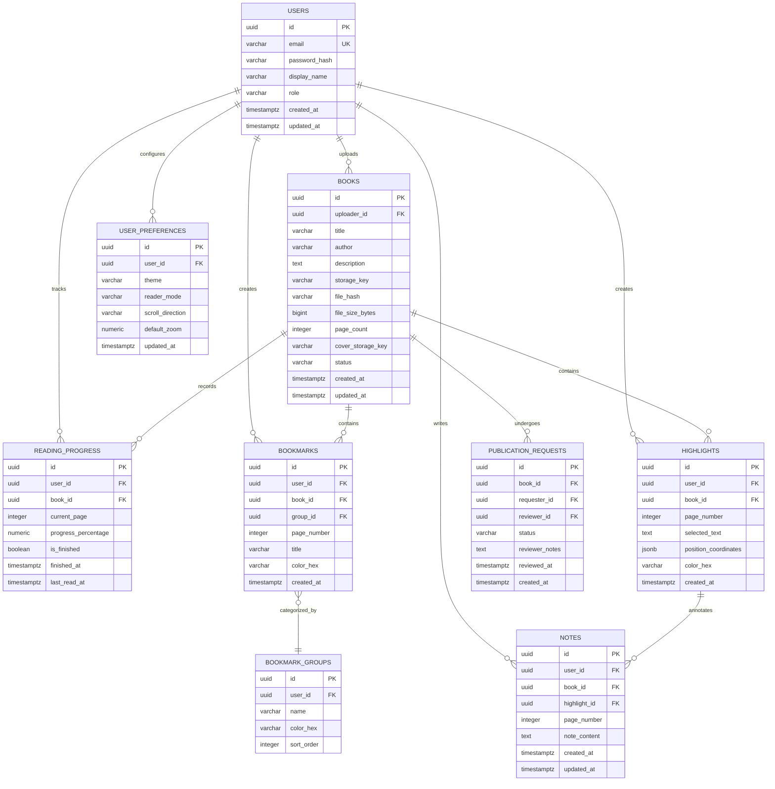

# OpenShelf — Preliminary Database Design

## 1. Overview & Strategy

OpenShelf relies on **PostgreSQL 17** for all relational and transactional metadata. File binaries (PDFs and generated cover images) are strictly separated from relational tables and stored in dedicated object storage.

Schema evolution is exclusively managed through **Flyway migration scripts** located in `src/main/resources/db/migration/`. Manual schema edits and automated JPA DDL mutations (`hibernate.ddl-auto=update` or `create`) are prohibited in all environments.

---

## 2. Preliminary Entity-Relationship Diagram

---

## 3. Data Storage Responsibility Matrix

| Data Item | Storage Engine | Access Control Mechanism |
| :--- | :--- | :--- |
| User Credentials & Roles | PostgreSQL (`users`) | Spring Security Authentication |
| Book Relational Metadata | PostgreSQL (`books`) | Privacy status check (`PRIVATE` vs `PUBLIC`) |
| PDF Document Binaries | Object Storage (Local FS / S3) | Streamed via authenticated backend endpoint or signed URLs |
| Book Cover Images | Object Storage (Local FS / S3) | Public or authenticated endpoint |
| User Reading Progress | PostgreSQL (`reading_progress`) | Strict user ownership: `user_id = auth.user_id` |
| Bookmarks & Annotations | PostgreSQL (`bookmarks`, `notes`) | Strict user ownership: `user_id = auth.user_id` |
| Coordinates / Text Ranges | PostgreSQL JSONB (`highlights`) | Strict user ownership: `user_id = auth.user_id` |

---

## 4. Key Indexing & Query Considerations

- **Unique Compound Keys:**
  - `reading_progress (user_id, book_id)` must enforce uniqueness so each reader has exactly one active progress record per book.
  - `user_preferences (user_id)` enforces a single preference profile per user.
- **Search Optimization:**
  - `books (title, author)` with PostgreSQL `pg_trgm` or B-Tree indexes for fast auto-complete and catalog search.
- **Performance Indexes:**
  - `bookmarks (user_id, book_id, page_number)` for fast rendering of bookmark ribbons on the active reading page.
  - `highlights (user_id, book_id, page_number)` for loading only the annotations relevant to the visible page spread.
