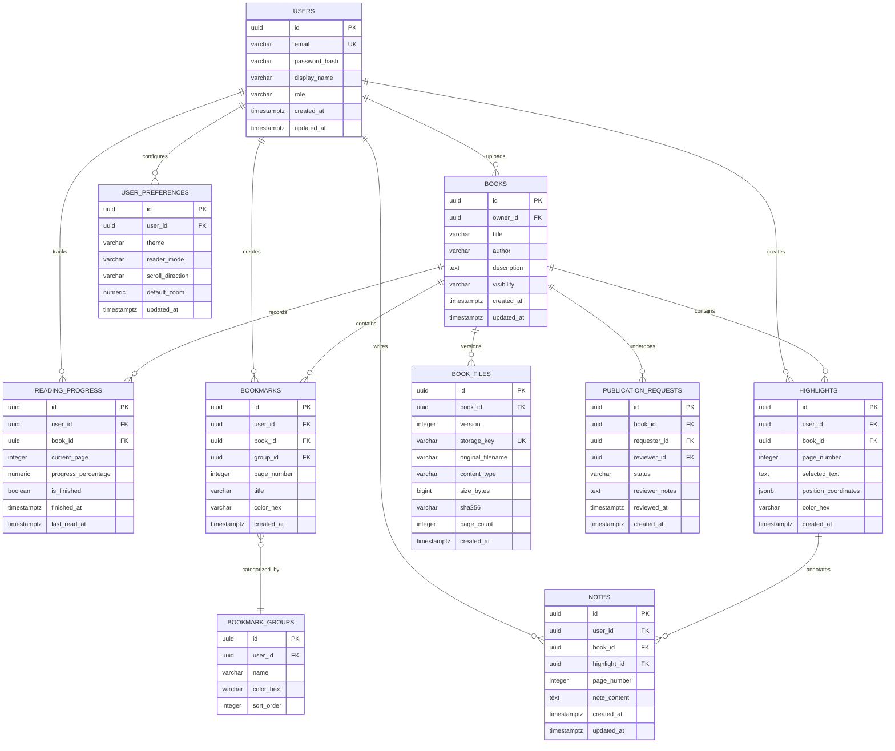

# OpenShelf — Database Design

> **Implementation status (2026-11-13):** `users` (V2), `books`, and `book_files` (V3) are implemented. Reading progress, annotations, publication, and preferences tables below remain preliminary. V1 and V2 are unchanged; Hibernate uses `validate`, with automatic Flyway baselining disabled. Milestone 2 verification uses disposable databases; pending V2/V3 migrations apply to the normal development database on its next normal startup, without reset. See [the upload milestone report](../development/upload-milestone-2.md).

## 1. Overview & Strategy

OpenShelf relies on **PostgreSQL 17** for all relational and transactional metadata. File binaries (PDFs and generated cover images) are strictly separated from relational tables and stored in dedicated object storage.

Schema evolution is exclusively managed through **Flyway migration scripts** located in `src/main/resources/db/migration/`. Manual schema edits and automated JPA DDL mutations (`hibernate.ddl-auto=update` or `create`) are prohibited in all environments.

### Implemented V3: private books and file versions

`V3__create_private_books.sql` introduces only:

- `books`: UUID primary key, `owner_id` foreign key to `users`, required trimmed title/author (maximum 200 characters), description (maximum 4,000, empty default), `visibility` defaulting to and constrained to `PRIVATE`, and UTC creation/update timestamps. The `(owner_id, created_at DESC, id DESC)` index supports ownership-scoped deterministic library pagination.
- `book_files`: UUID primary key, `book_id` foreign key with cascade metadata deletion, positive integer version, unique relative UUID `.pdf` storage key, sanitized original filename, server-determined `application/pdf` content type, positive size/page count, lowercase SHA-256, and UTC creation time. Unique `(book_id, version)` supports future immutable versions; only version 1 is created now.

The API exposes book/file IDs and integrity metadata, never storage keys or absolute paths. File IDs form the reader's immutable document-version key. Book and file metadata commit in one transaction after PDF validation; a failed transaction deletes the newly stored binary. Local disk and PostgreSQL are not a distributed transaction: abrupt termination or failed filesystem cleanup can require orphan reconciliation. No automatic file deletion is attached to direct SQL cascade deletes; there is no book deletion API in this milestone.

Database ownership comes exclusively from the session principal, not form input. Owner-scoped joins guard detail/file/list access; missing and foreign-owned books return the same 404. No role bypass exposes another user's private PDFs. See [API conventions](api-conventions.md#6-private-book-contracts-milestone-2).

---

## 2. Preliminary Entity-Relationship Diagram

---

## 3. Data Storage Responsibility Matrix

| Data Item | Storage Engine | Access Control Mechanism |
| :--- | :--- | :--- |
| User Credentials & Roles | PostgreSQL (`users`) | Spring Security Authentication |
| Book Relational Metadata | PostgreSQL (`books`) | Privacy status check (`PRIVATE` vs `PUBLIC`) |
| PDF Document Binaries | Object Storage (Local FS / S3) | Streamed via authenticated backend endpoint or signed URLs |
| Book Cover Images | Object Storage (Local FS / S3) | Public or authenticated endpoint |
| User Reading Progress | PostgreSQL (`reading_progress`) | Strict user ownership: `user_id = auth.user_id` |
| Bookmarks & Annotations | PostgreSQL (`bookmarks`, `notes`) | Strict user ownership: `user_id = auth.user_id` |
| Coordinates / Text Ranges | PostgreSQL JSONB (`highlights`) | Strict user ownership: `user_id = auth.user_id` |

---

## 4. Key Indexing & Query Considerations

- **Unique Compound Keys:**
  - `reading_progress (user_id, book_id)` must enforce uniqueness so each reader has exactly one active progress record per book.
  - `user_preferences (user_id)` enforces a single preference profile per user.
- **Search Optimization:**
  - `books (title, author)` with PostgreSQL `pg_trgm` or B-Tree indexes for fast auto-complete and catalog search.
- **Performance Indexes:**
  - `bookmarks (user_id, book_id, page_number)` for fast rendering of bookmark ribbons on the active reading page.
  - `highlights (user_id, book_id, page_number)` for loading only the annotations relevant to the visible page spread.
