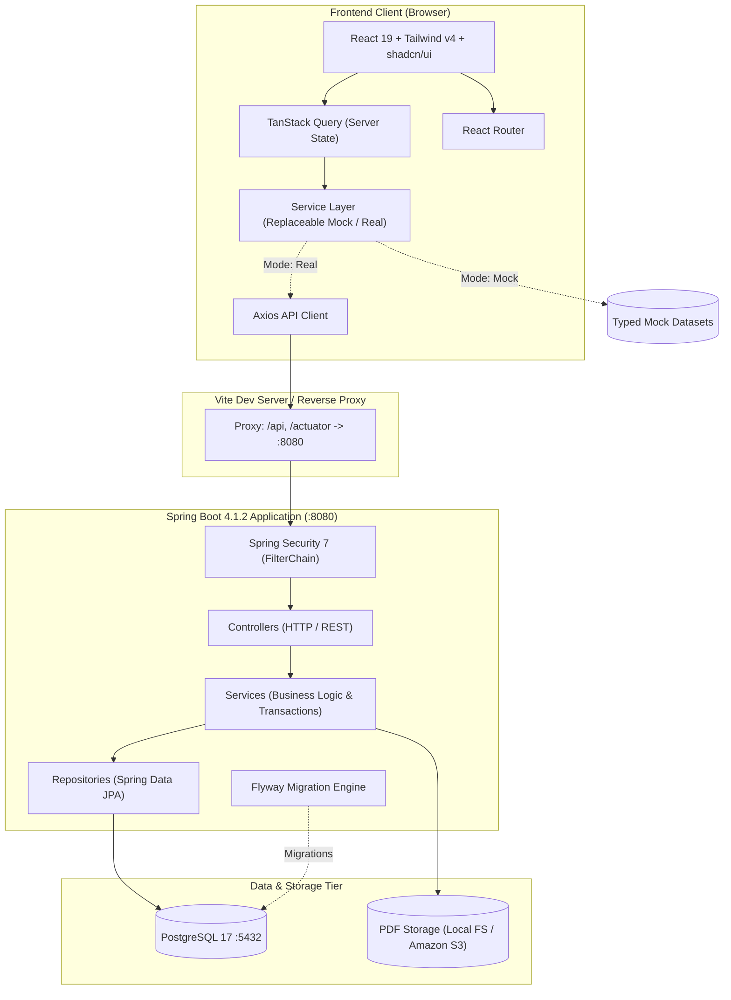
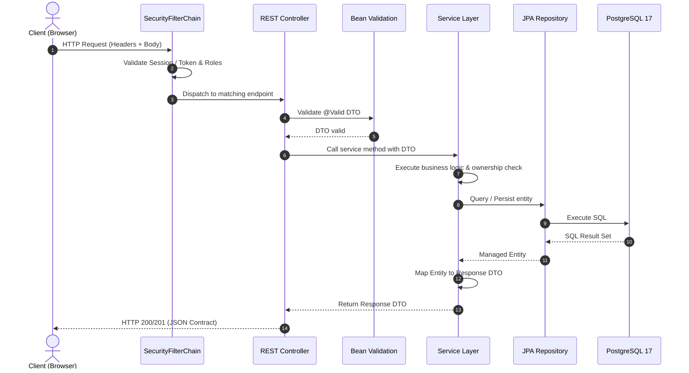

# OpenShelf — System Architecture & Design

## 1. High-Level Architecture Overview

OpenShelf is structured as a **Monorepo with Traditional Layered Architecture**. The platform consists of a single-page React frontend, a RESTful Spring Boot 4.1.2 backend, a PostgreSQL 17 relational database, and an object storage tier for PDF binaries (local filesystem during development, Amazon S3 for production).



---

## 2. Layer Responsibilities & Boundaries

### 2.1 Frontend Responsibilities (React + TypeScript)
- **Presentation:** Render user interfaces using styled shadcn/ui components and Tailwind CSS v4 utility classes.
- **Client Routing:** Page navigation and URL synchronization via React Router.
- **Server State Management:** Asynchronous query fetching, caching, deduplication, and cache invalidation via TanStack Query.
- **Replaceable Service Abstraction:** Dedicated service modules (`src/services/`) decouple UI components from network transport, enabling rapid mock prototyping and seamless API integration.
- **Reader Engine:** High-performance PDF rendering using PDF.js inside a dedicated reader canvas layer.
- **Local Preferences:** Storing transient UI preferences (e.g. sidebar toggle, zoom setting).

### 2.2 Backend Responsibilities (Spring Boot + Java 21)
- **API Boundary:** Expose RESTful endpoints, perform Bean Validation, and map incoming JSON contracts.
- **Business Operations:** Enforce business invariants, privacy boundaries, publication workflows, and role checks.
- **Security & Authorization:** Token authentication, resource-level ownership verification, and security filter enforcement.
- **Data Persistence:** Relational data mapping, optimistic locking, and transaction boundaries.
- **Binary Streaming:** Chunked, stream-optimized delivery of PDF files with HTTP range header support.

---

## 3. Frontend-First Strategy & Replaceable Service Layer

OpenShelf uses a **Frontend-First development workflow after Authentication**. This decouples UI/UX exploration from backend schema finalization.

### 3.1 Replaceable Service Pattern
To enable full interactivity before backend endpoints are built:
1. **Contract First (`src/types/`):** All domain models (`Book`, `ReadingProgress`, `Bookmark`, etc.) are defined as strict TypeScript interfaces mirroring future backend DTO schemas.
2. **Service Abstraction (`src/services/`):** UI components invoke high-level service functions (e.g., `getBookCatalog()`, `saveProgress()`), never raw URLs or axios instances directly.
3. **Mock Data Layer (`src/services/mocks/`):** During Phase 3, services return typed mock data wrapped in Promises with simulated network latency:
   ```typescript
   export async function getBookCatalog(): Promise<ApiResponse<Book[]>> {
     if (isMockMode()) {
       await delay(300);
       return { success: true, data: MOCK_BOOKS, timestamp: new Date().toISOString() };
     }
     const response = await apiClient.get<ApiResponse<Book[]>>('/api/v1/books');
     return response.data;
   }
   ```
4. **Seamless Integration (Phase 5):** When backend endpoints are deployed, switching `VITE_USE_MOCK_API=false` redirects traffic to the Spring Boot REST API without modifying any page or component code.

### 3.2 Clear Mock vs. Integrated Differentiation
- Development builds display a persistent, non-intrusive `MockDataBadge` when mock services are active.
- Features backed by real backend APIs (such as Authentication in Phase 1) communicate directly with the live server.

### 3.3 Real PDF Validation in Prototyping
- The Web PDF Reader component must never rely on mocked canvas stubs.
- Reader UI, page-turning, dual-page layout, and zoom controls are validated against a real binary (`public/sample.pdf`) during the frontend phase.

---

## 4. Strict Monorepo Layered Architecture

OpenShelf strictly prohibits package-by-feature or modular feature packaging. All code is grouped by technical responsibility.

### 4.1 Backend Package Organization
```text
com.openshelf/
├── OpenshelfApplication.java  # Application entrypoint
├── controller/                # REST Controllers (thin HTTP adapters)
├── service/                   # Business services & transaction boundaries
├── repository/                # Spring Data JPA repositories
├── entity/                    # JPA domain entities (not exposed to API)
├── dto/
│   ├── request/               # Inbound API payload contracts
│   └── response/              # Outbound API response models
├── mapper/                    # Entity <-> DTO conversion mappers
├── config/                    # Spring @Configuration classes
├── security/                  # Security filter chains, token handlers
├── exception/                 # Custom domain exceptions & @ControllerAdvice
├── storage/                   # Storage abstraction (Local & S3)
├── validation/                # Custom validation annotations & validators
├── enums/                     # Domain & status enumerations
└── util/                      # Shared static utilities
```

### 4.2 Frontend Folder-by-Type Structure
```text
frontend/src/
├── assets/                    # Static image/media assets
├── components/
│   ├── ui/                    # Base shadcn/ui components (Button, Card, etc.)
│   ├── layout/                # Shell, AppHeader, AppSidebar, MobileNav
│   ├── books/                 # Book cards, grid, upload modals
│   ├── reader/                # PDF viewer canvas, toolbar, annotations drawer
│   └── common/                # Shared UI dialogs, spinners, alerts, badges
├── pages/                     # Top-level page routes
├── services/                  # Replaceable API service calls and mock datasets
│   └── mocks/                 # Typed mock data records
├── hooks/                     # Custom React hooks
├── contexts/                  # React contexts (AuthContext, etc.)
├── providers/                 # React Context and Query providers
├── types/                     # Shared TypeScript interfaces & DTO contracts
├── utils/                     # Generic utility functions
├── lib/                       # shadcn helper utilities (cn)
├── routes/                    # Route declarations and ProtectedRoute
└── styles/                    # Global CSS and Tailwind directives
```

---

## 5. Backend Request Execution Flow



---

## 6. Security Principles

1. **Deny by Default:** All endpoints require authenticated access except designated public routes (e.g. `/actuator/health`, `/api/v1/auth/**`, public catalog queries).
2. **Resource Ownership Verification:** Every access to private books, bookmarks, highlights, or reading progress must explicitly assert that the resource belongs to the authenticated user ID (`owner_id == currentUser.id`).
3. **No Entity Leakage:** Internal JPA entities must never be returned directly in REST controllers. All API responses use explicit DTOs.
4. **Credential Isolation:** Database credentials and signing secrets are injected strictly via environment variables; never checked into version control.
