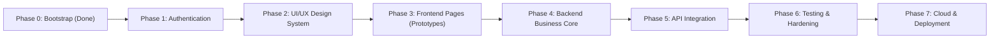

# OpenShelf — Development Roadmap & Implementation Phases

> **Workflow Strategy:** Frontend-First Development after Authentication  
> **Architecture Mandate:** Traditional Layered Architecture (Backend) + Folder-by-Type Architecture (Frontend)

---

## Roadmap Overview

---

## Phase 0: Project Initialization & Bootstrap (Completed)

- [x] Monorepo workspace initialization with clean root structure.
- [x] Docker Compose setup with PostgreSQL 17 Alpine and health check on `127.0.0.1:5432`.
- [x] Spring Boot 4.1.2 backend bootstrap with Java 21 LTS (`--release 21`), Flyway baseline (`V1__init.sql`), Spring Security 7, and Actuator.
- [x] Complete backend Layered Architecture packages registered with `package-info.java`.
- [x] React 19 + TypeScript + Vite 8 + Tailwind CSS v4 + shadcn/ui frontend bootstrap.
- [x] Folder-by-type architecture established for frontend.
- [x] Central Axios client, TanStack Query provider, and Vite proxy configuration (`/api`, `/actuator` -> `:8080`).
- [x] Interactive bootstrap page verifying live end-to-end connectivity.
- [x] Comprehensive documentation suite and AI engineering governance (`AGENTS.md`).

**Milestone:** Verified full-stack baseline running across Docker, Spring Boot, and React.  
**Acceptance Criteria:** `mvnw clean test` passes with 0 failures; `npm run build` passes with 0 errors; `/actuator/health` returns HTTP 200 `UP`.

---

## Phase 1: Full-Stack Authentication & User Management

**Status (2026-11-12):** Approved, implemented, and verified. The [Authentication design](../architecture/authentication-design.md) defines the accepted session/CSRF/Argon2id contract; the [implementation report](phase-1-implementation.md) records the Phase 1 checks. Phase 2 subsequently preserved and reverified these authentication flows.

### Objectives
Establish registration, login, current-user retrieval, logout, and secure browser session management across backend and frontend before initiating feature prototyping. Evaluate recovery and email verification separately before a public production launch.

### Tasks
- [x] **Database Migration:** Create `V2__create_users_table.sql` (UUID, email, password_hash, display_name, role, timestamps).
- [x] **Backend Domain & Persistence:** Create `User` entity, `Role` enum (`ROLE_USER`, `ROLE_ADMIN`), and `UserRepository`.
- [x] **Isolated Tests:** Move context/integration tests to disposable PostgreSQL 17 Testcontainers databases before adding write operations; propagate Maven failures from the test helper.
- [x] **Security:** Configure Argon2id password hashing, Spring Security session authentication, fixation protection, explicit context persistence, JSON security errors, and bounded credential throttling.
- [x] **Auth REST API:** Implement `AuthController` and `AuthService`:
  - `GET /api/v1/auth/csrf` (public, session-backed masked CSRF token).
  - `POST /api/v1/auth/register` (with Jakarta Bean Validation).
  - `POST /api/v1/auth/login` (credential verification, session rotation, and HttpOnly cookie).
  - `GET /api/v1/auth/me` (current authenticated user profile).
  - `POST /api/v1/auth/logout` (CSRF-protected server-session invalidation).
- [x] **Exception Handling:** Centralized `GlobalExceptionHandler` mapping validation errors, duplicate emails, and invalid credentials.
- [x] **Frontend Auth Layer:**
  - Browser-managed session cookie; CSRF token retained only in memory and renewed after login/logout.
  - Central Axios client using the same-origin proxy, credentials, and an explicit CSRF header for unsafe requests.
  - TanStack Query owns current-user server state; `AuthContext` and `useAuth` expose derived session state/actions.
- [x] **Frontend Auth Pages:**
  - Login page (`/login`) with form validation.
  - Registration page (`/register`) with form validation.
  - Protected route wrapper (`<ProtectedRoute />`) redirecting unauthenticated users.

**Milestone:** Complete registration, login, session persistence, and profile retrieval working end-to-end between React and Spring Boot.  
**Acceptance Criteria:**
- User can register with valid credentials; duplicate email returns HTTP 409 with user-friendly error.
- User can log in with a rotated server session; protected endpoints reject unauthenticated requests with JSON 401.
- Missing or invalid CSRF tokens reject unsafe requests, including login, registration, and logout.
- Refreshing the browser restores an active session via `/me`; logout immediately invalidates it. In-memory sessions expire after 30 idle minutes and are lost on backend restart.
- Passwords are stored as salted Argon2id hashes under the approved design.
- Integration and browser tests verify cookie attributes, role enforcement, CSRF rotation, session persistence, and logout using isolated databases.

---

## Phase 2: UI/UX Design System, Design Tokens & Core Layout

**Status (2026-11-12):** Implemented and verified. See the [design system](../design/design-system.md) and [Phase 2 implementation report](phase-2-implementation.md). Subsequent Phase 3 progress is recorded below.

### Objectives
Establish a cohesive, modern visual design system, typography scale, color palette, and responsive shell before building individual feature screens.

### Tasks
- [x] **Design System Foundations:**
  - Refine Tailwind CSS v4 design tokens in `src/styles/globals.css` (primary, secondary, muted, accent, borders, radius, shadows).
  - Configure Dark / Light mode CSS variables and theme toggle hook.
  - Typography scale and font stack for readability and book metadata display.
- [x] **Core Layout Components (`src/components/layout/`):**
  - `AppHeader`: Logo, navigation links, search trigger, theme toggle, and user profile avatar dropdown.
  - `AppSidebar`: Collapsible navigation for Discover, My Library, Continue Reading, Finished, Favourites, and My Published.
  - `MobileNav`: Responsive bottom bar or slide-out drawer for smartphone viewports.
  - `AppShell`: Persistent master layout container wrapping pages with header, sidebar, and main content area.
  - `PageHeading` composes breadcrumbs and the page title.
- [x] **Used Shared Primitives (`src/components/ui/`):**
  - Refined Button/Card; added Input, DropdownMenu, Dialog, and Badge. Forms retain native labels.
  - Defer Tabs, Tooltip, Skeleton, and Toast until a product screen needs them; avoid unused component scaffolding.
- [x] **Responsive Design Rules:**
  - Mobile (< 768px): Modal navigation drawer and single-column demonstration cards.
  - Tablet (768–1023px): Compact icon rail and two-column demonstration cards.
  - Desktop (>= 1024px): Expanded/collapsible sidebar and editorial content area.
  - Reader layout and product book grids remain Phase 3 work.
- [x] **Authentication Integration and Layout Demonstration:**
  - Preserve Phase 1 session/CSRF services and protected routes; restyle forms and account using the shared tokens.
  - Clearly caption decorative Home covers and protected shelf routes as layout previews.
  - Page/shelf search is local navigation only; it does not implement catalog search.
- [x] **Verification:** 26 frontend tests, TypeScript app/test checks, production build, lint, 19 isolated backend tests, and 15 Edge browser tests passed. Eight light/dark screenshots at 375/768/1280/1440px were visually inspected; tested states have no automated WCAG A/AA violations or horizontal overflow.

**Milestone:** Responsive application shell with theme switching, accessible navigation, and used shared primitives demonstrated on a small preview page.
**Acceptance Criteria:**
- Application shell adapts seamlessly across mobile (375px), tablet (768px), and desktop (1280px+).
- Light/dark themes preserve layout geometry; keyboard focus, modal behavior, touch controls, guest/authenticated navigation, and existing logout work. Font-display swap permits normal font loading changes; a zero-CLS performance audit was not claimed.

---

## Phase 3: Frontend Pages & Interactive Prototypes (Frontend-First)

**Status (2026-11-14):** Core Reading Milestones 1-3 implement the protected PDF Reader, private upload/storage, and database-backed account progress with Continue Reading. These explicitly authorized backend slices retain the frontend-first architecture and sample demo. See [Milestone 3](reading-progress-milestone-3.md), [Upload Milestone 2](upload-milestone-2.md), and [Reader Milestone 1](reader-milestone-1.md). Wider catalog, shelves, annotations, publication and moderation remain future work. Recommended next: **Private Bookmarks**, scoped separately with file-version ownership and Reader navigation.

### Objectives
Construct all key application screens, user workflows, and the Web PDF Reader using typed contracts, rich mock data, and a replaceable service layer—**without implementing backend business logic prematurely**.

### Tasks
- [ ] **Typed Contracts & Mock Data (`src/types/`, `src/services/mocks/`):**
  - Define complete TypeScript interfaces matching future backend DTOs:
    - `Book`, `BookDetail`, `BookUploadPayload`, `PublicationRequest`.
    - `ReadingProgress`, `Bookmark`, `Highlight`, `Note`, `ReaderPreferences`.
  - Create rich, realistic mock datasets for books, categories, progress, and annotations.
  - Implement a **replaceable service layer**:
    - `bookService.ts`: mock endpoints with simulated latency (`setTimeout`) for catalog, library, search, and details.
    - `progressService.ts`: mock save/load progress.
    - `annotationService.ts`: mock bookmark, highlight, and note CRUD.
    - `moderationService.ts`: mock submission and review queue.
  - Provide a visual `MockDataBadge` in development mode to clearly differentiate mock data from live backend data.
- [ ] **Discovery & Catalog Page (`/` / `/explore`):**
  - Hero banner, search bar with debounce, category/genre filter pills.
  - Book card grid (`src/components/books/BookCard.tsx`) with cover image, author, rating placeholder, and reading status badge.
  - Empty states, loading skeletons, and pagination controls.
- [ ] **Personal Library Pages (`/library`):**
  - Tabbed library views: Continue Reading, Finished Books, My Library, My Published Books, My Favourites.
  - Sorting (recently read, title, date added) and quick action menus (continue, remove, bookmark).
- [ ] **Book Detail Page / Modal (`/books/:id`):**
  - Cover preview, full metadata, synopsis, publication status badge, action buttons (Read Now, Add to Library, Publish Request).
- [ ] **Book Upload & Publish Dialogs (`src/components/books/`):**
  - Drag-and-drop PDF upload zone with client-side file size and format validation.
  - Metadata entry form (title, author, description, tags, license declaration).
  - Publication request dialog with terms and copyright confirmation.
- [ ] **Web PDF Reader UI (`/read/:bookId`):**
  - Integrate PDF.js with dedicated worker script.
  - Dual rendering modes: Single-page view and Double-page (book spread) view.
  - Navigation controls: vertical continuous scroll and horizontal page-flip stepping.
  - Viewport controls: zoom in/out, fit-to-width, fit-to-page, fullscreen toggle.
  - Reading progress bar with page number input jumper.
  - **Sample PDF Validation:** Validate reader layout, canvas scaling, and responsiveness using a real sample PDF binary bundled in `public/sample.pdf`.
- [ ] **Annotations & Bookmarks UI (`src/components/reader/`):**
  - Bookmark ribbon toggle and bookmark management panel (with color tags and custom labels).
  - Text selection toolbar with highlight color picker.
  - Slide-out annotations drawer showing bookmarks, highlights, and page-anchored notes.
- [ ] **Admin Moderation Queue Page (`/admin/moderation`):**
  - Queue listing pending publication requests.
  - Review drawer with book preview, license assertions, and Approve / Reject action modals with reviewer feedback.

**Milestone:** Fully navigable, interactive frontend prototype covering all core requirements, verified with a real sample PDF.  
**Acceptance Criteria:**
- All pages navigable without console errors; TypeScript strictly typed (zero `any`).
- Reader loads and renders `sample.pdf` accurately in single-page and double-page modes.
- Annotations and bookmarks can be created and manipulated in mock state.
- Responsive across all target breakpoints.

---

## Phase 4: Backend Business Development & Persistence Core

### Objectives
Implement backend business logic, database entities, file storage abstractions, and transactional services to fulfill the contracts established during the frontend phase.

### Tasks
- [ ] **Database Schema Migrations (Flyway):**
  - [x] `V3__create_private_books.sql`: implemented private `books` and immutable `book_files`, with ownership, file integrity metadata, and version constraints. V1/V2 remain unchanged.
  - [x] `V4__create_reading_progress.sql`: user/book/file-version keys, unique `(user_id, book_file_id)`, positive current/furthest pages, atomic maximum, UTC timestamps and recent-reading indexes. Percentage is derived; Finished Books is not implemented.
  - **Proposed only:** `V5__create_private_bookmarks.sql` for bookmarks and bookmark_groups, following the [Milestone 4 design](../architecture/bookmark-design.md). No V5 file exists yet. This narrows the earlier combined-annotations placeholder; highlights and notes require separately scoped later migrations. Milestone 4 implementation is not authorized by the design task.
  - `V6__create_publication_requests_table.sql`: book_id, requester_id, reviewer_id, status, reviewer_notes, timestamps.
- [ ] **File Storage Abstraction (`com.openshelf.storage`):**
  - [x] `StorageService` interface and `LocalStorageService`, stable absolute configuration, generated keys, bounded writes, cleanup, SHA-256 integrity hashing, and private Resource retrieval.
  - Deduplication and alternate storage implementations remain deferred; identical PDFs may be independent private uploads.
- [ ] **Backend Entities & Repositories:**
  - [x] `Book`, `BookFile`, and repositories implemented for Milestone 2.
  - [x] `ReadingProgress` and repository implemented in Milestone 3; bookmarks, highlights, notes and publication requests remain deferred.
  - JPA repositories with ownership-scoped queries (`findByUserIdAndBookId`, etc.).
- [ ] **Business Services (`com.openshelf.service`):**
  - `BookService`: upload handling, metadata extraction (page count via PDFBox/Tika), private-by-default enforcement, deletion cascades.
  - [x] `ReadingProgressService`: owner/latest-version checks, page validation, atomic upsert, derived percentage and paginated recent reading; no auto-finish triggers.
  - `AnnotationService`: bookmark, highlight, and note operations with strict user ownership validation.
  - `PublicationService`: submit request, admin approve/reject workflow with status transitions.
- [ ] **REST Controllers (`com.openshelf.controller`):**
  - [x] Milestone 2 `BookController`: CSRF-protected multipart creation, owner-scoped library/detail, and authenticated full/range PDF delivery at `/api/v1/books/{id}/file`.
  - [x] Milestone 3 `ReadingProgressController`: GET/PUT `/books/{id}/progress`, GET `/library/continue-reading`; annotations/publications remain deferred.
  - HTTP Range streaming endpoint for PDF viewing (`GET /api/v1/books/{id}/stream`).

**Milestone:** All backend services, schema migrations, and REST controllers implemented and unit/integration tested.  
**Acceptance Criteria:**
- Flyway migrations execute cleanly from scratch on an empty PostgreSQL database.
- Private books and reading data strictly inaccessible to unauthorized users (HTTP 403 / 404).
- PDF streaming endpoint supports partial content (`HTTP 206 Partial Content`).
- Unit and integration tests pass with high branch coverage.

---

## Phase 5: API Integration & Replaceable Service Layer Swap

### Objectives
Connect the frontend components to the live Spring Boot REST APIs by swapping out mock services, verifying end-to-end data flow.

### Tasks
- [ ] **Service Layer Replacement:**
  - Transition `src/services/` from mock functions to actual Axios calls hitting `/api/v1/*`.
  - Private books/progress always use live APIs; only `/read/sample` uses explicit mock metadata/local progress. Do not silently fall back to mock/private local data.
- [ ] **TanStack Query Mutation Wiring:**
  - Connect upload form to `useMutation` calling `POST /api/v1/books`.
  - [x] Connect private reader progress to debounced, serial `PUT /api/v1/books/{id}/progress`, confirmed status/retry, restoration and real Continue Reading.
  - Connect bookmark, highlight, and note creation to backend endpoints.
  - Invalidate relevant query caches upon successful mutations.
- [ ] **PDF Reader Live Streaming:**
  - Connect reader PDF.js document loader to authenticated streaming endpoint `/api/v1/books/{id}/stream`.
- [ ] **Publication Workflow Integration:**
  - User submission triggers real `POST /api/v1/books/{id}/publish`.
  - Admin moderation actions update live book status.
- [ ] **Error Handling & Feedback Polish:**
  - Map backend RFC 7807 error responses to frontend toast notifications and inline form errors.

**Milestone:** Complete frontend operating entirely on live PostgreSQL and Spring Boot data with mock data disabled.  
**Acceptance Criteria:**
- Real PDF upload stores binary in local storage, metadata in DB, and opens immediately in Web Reader.
- Reading progress persists across separate devices / browsers upon user login.
- Publication approval workflow updates public discovery catalog in real time.

---

## Phase 6: End-to-End Testing, Hardening & Polishing

### Objectives
Comprehensive verification across security, performance, cross-browser compatibility, and accessibility.

### Tasks
- [ ] **Automated Testing Suite:**
  - Backend integration tests using Spring Boot Test and Testcontainers.
  - Frontend component tests using Vitest and React Testing Library.
  - Critical path end-to-end tests (Register -> Upload -> Read -> Bookmark -> Publish -> Moderate).
- [ ] **Security & Authorization Audit:**
  - Verify IDOR protection: User A cannot fetch User B's private book or annotations.
  - Verify role protection: Non-admin cannot access `/api/v1/admin/**`.
  - File upload safety checks: reject non-PDF MIME types, enforce size caps.
- [ ] **Performance & Reader Optimization:**
  - Virtualized rendering for long PDF documents (500+ pages) to limit DOM memory usage.
  - Image optimization for book covers and avatars.
  - Lighthouse performance audit score >= 90.

**Milestone:** Hardened, production-ready codebase with zero security vulnerabilities and passing automated test suites.  
**Acceptance Criteria:**
- 100% automated regression test pass rate.
- Verified absence of access control vulnerabilities.

---

## Phase 7: Cloud Infrastructure, Production Deployment & Future Social Features

### Objectives
Production packaging, cloud storage integration, and community feature expansion.

### Tasks
- [ ] **Amazon S3 Integration:** Implement `S3StorageServiceImpl` with presigned upload/download URLs.
- [ ] **Production Docker Containers:** Multi-stage Dockerfiles for Spring Boot (distroless/JRE) and React (Nginx Alpine).
- [ ] **CI/CD Pipeline:** GitHub Actions workflow executing build, lint, backend tests, and Docker image publishing.
- [ ] **Future Social Expansion:** Book reviews, 5-star ratings, community collections, public user profiles.

**Milestone:** Live production deployment on cloud infrastructure.
